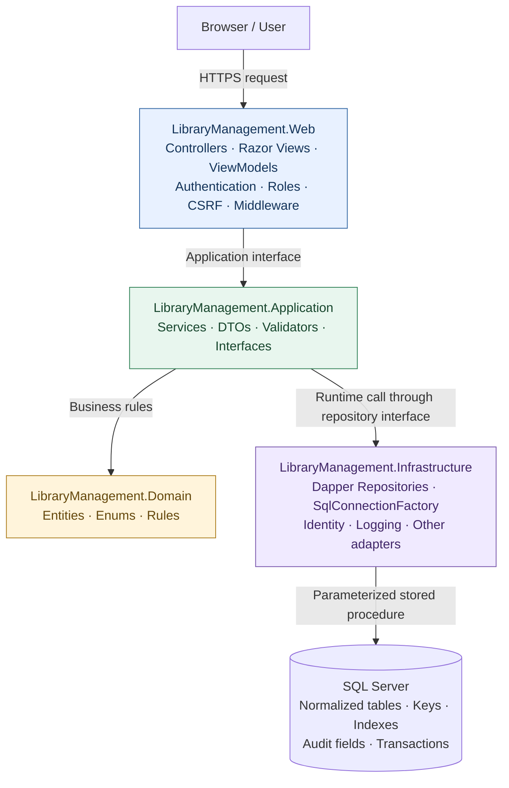
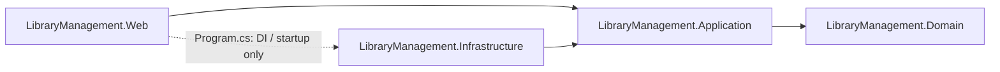

# Library Management — Architecture Flow

Verified against the current four-project MVC solution.

## 1. Business request flow



Is diagram ke arrows **runtime calls** dikhate hain. A normal book/member/circulation request Web se Application service aur repository interface ke through Infrastructure tak jati hai. Dapper SQL Server procedure execute karta hai. Results wapas Repository → Service → Controller aate hain; Razor HTML render karta hai. Successful writes usually redirect to a GET page. AJAX actions return a bounded JSON result from the same MVC application.

Authentication uses Application-owned account/session interfaces implemented by Infrastructure Identity adapters. Domain entities and rules remain independent of MVC and SQL Server.

## 2. Project dependency direction



Ye arrows **project references** dikhate hain. Application, Infrastructure implementation ko reference nahi karta. Infrastructure Application ke interfaces implement karta hai; Program.cs dependency injection se implementation connect karta hai. Web ka Infrastructure reference startup/composition ke liye hai. Domain has no project dependencies.

## 3. Example: book issue

```mermaid
sequenceDiagram
    actor Reader as Staff user
    participant Web as LoansController (Web)
    participant App as BookIssueService / LibraryService (Application)
    participant Rules as LendingRules (Domain)
    participant Repo as LibraryRepository (Infrastructure)
    participant SQL as SQL Server
    Reader->>Web: Submit issue form with CSRF token
    Note over Web: Authenticate, authorize staff, validate binding
    Web->>App: IBookIssueService.IssueAsync
    App->>Rules: Validate due date
    App->>Repo: ILibraryRepository.IssueAsync
    Repo->>SQL: library.Loans_Issue + parameters
    Note over SQL: BEGIN TRANSACTION<br/>Lock member and book; check stock, duplicates and policy<br/>Insert loan and audit event; COMMIT or ROLLBACK
    SQL-->>Repo: New loan ID
    Repo-->>App: New loan ID
    App-->>Web: New loan ID
    Web-->>Reader: Redirect to receipt; Razor renders HTML
```

Return aur fine payment bhi Dapper procedure calls ke through atomic SQL transactions use karte hain. Security headers, safe global exception handling aur Serilog request logging request pipeline ko cover karte hain.

## Folder responsibilities

| Project | Main folders | Responsibility |
| --- | --- | --- |
| LibraryManagement.Web | Controllers, Views, ViewModels, ViewComponents, wwwroot, Middleware, Filters | HTTP request, security, form binding and UI |
| LibraryManagement.Application | Interfaces, Services, DTOs, Validators | Use cases, validation and contracts |
| LibraryManagement.Domain | Entities, Enums, Rules, Exceptions | Business concepts and rules |
| LibraryManagement.Infrastructure | Data, Repositories, Identity, Logging, Email, Images, Reporting | Persistence and framework/external adapters |

SQL Server tables: Users, Members, Categories, Authors, Publishers, Books, BookCovers, Loans, Payments, FinePolicy, UserSessions and AuditEvents.

Related guides: [Architecture](Architecture.md), [Database](Database.md), [Security](Security.md). The standalone ArchitectureFlow.mmd file contains the main request diagram for a Mermaid editor.
