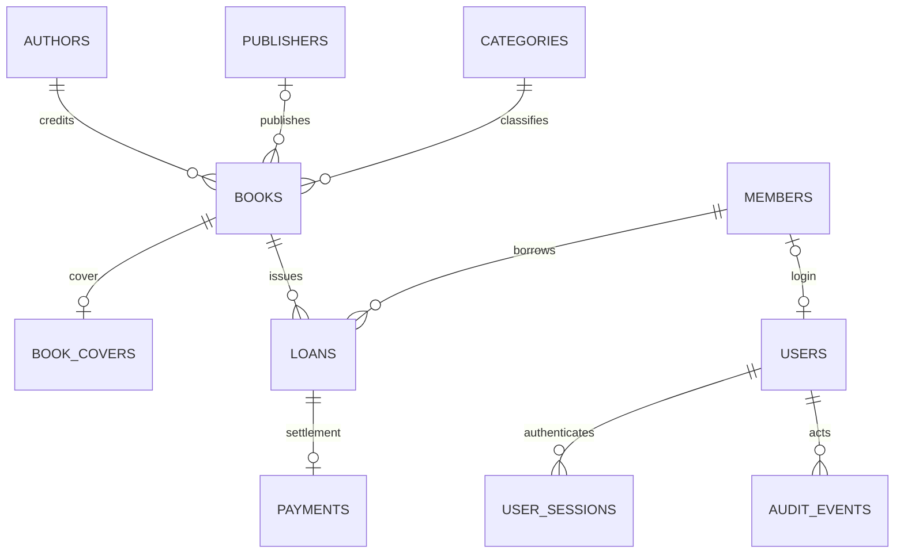

# SQL Server database design and audit fields

The application uses SQL Server through Dapper, with fixed stored procedure names and parameter objects. Schema 13 normalizes catalog references and adds a consistent audit projection to every library table without replacing library records.

## Tables and relationships

| Table | Key and purpose | Main references / unique rules |
| --- | --- | --- |
| Users | Id, Identity accounts | Unique normalized username/email; optional unique MemberId; checked role/membership; audit users reference Users |
| Members | Id, member/contact/membership records | Unique MemberNumber and Email |
| Categories | Id, category labels | Unique Name |
| Authors | Id, shared author credit labels | Unique Name |
| Publishers | Id, shared publisher labels | Unique Name |
| Books | Id, title/ISBN/stock | Unique ISBN; CategoryId, AuthorId and optional PublisherId FKs |
| BookCovers | BookId, reconstructed cover | One-to-one Books FK; JPEG type/size checks; soft removal |
| Loans | Id, one issue transaction | BookId, MemberId, IssuedBy/ReturnedBy; filtered unique active member/book pair |
| Payments | Id, one finalized fine payment | Unique LoanId FK; ReceivedBy; positive amount |
| FinePolicy | Id=1, library settings | Singleton check; lending/rate/duration bounds |
| UserSessions | Id, server session | UserId FK; issued/seen/expiry/revocation timestamps |
| AuditEvents | Id, append-only business activity | ActorId FK; occurrence/action/entity reference |

Books now store AuthorId and PublisherId rather than repeated author/publisher labels. BookCatalog joins the shared labels for existing Razor screens, Dapper models and reports. The existing author field represents one author credit label per book; matching labels use the database's collation and one shared row. This is not a personal-identity registry or a multiple-author catalog. Optional blank publishers normalize to NULL. Other relationships retain their existing IDs and records. Stock availability is derived from active loans; report totals and payment status are computed from their source facts.

All tables have primary keys. Relationships and all CreatedBy/ModifiedBy/DeletedBy fields use foreign keys with no cascading purge of history. Unique constraints protect identifiers and labels; check constraints protect stock, settings, membership/date, image and payment invariants. New indexes support category/author/publisher lookups, member/book issue history, payment dates and deletion audit searches; existing active-loan, ISBN/member/email and activity indexes remain.

## Standard audit columns

Every library table exposes these exact names:

- CreatedDate — UTC creation time; CreatedBy — creating user ID.
- ModifiedDate — last recorded change time; ModifiedBy — actor for that change.
- DeletedDate — current soft-deletion time; DeletedBy — deleting user ID.

These are DateTime2 / nullable user-ID values. Existing canonical timestamps are retained: CreatedDate is a persisted computed alias over CreatedAt or the already-recorded event creation timestamp (IssuedAt, PaidAt, OccurredAt). For Users and FinePolicy, ModifiedDate aliases ModifiedAt. There is one underlying date value, so legacy date names and existing date-index/report behavior stay consistent. Other tables use physical audit date fields with UTC defaults for future inserts. Unknown historical creators/timestamps remain NULL; migration never invents a user or pretends a historical record was created today. Known issue/payment/event/session creators are backfilled from their existing actor FKs.

Book, Member, Loan and Category share Domain.Entities.AuditedEntity. Dapper reads these columns by name. Write adapters explicitly send allowed business fields and the signed actor ID; posted audit values and posted lookup IDs do not control persistence.

Book/member delete procedures populate DeletedDate/DeletedBy and preserve the row/history. Restore clears the current deletion markers and records the restoring actor as modifier; the AuditEvents history remains. Cover removal now marks its row deleted, excludes it from reads/HasCover, and retains deletion metadata. Uploading another cover clears its deletion marker. Account deactivate and session revoke retain their own semantics and update modification metadata; they are not represented as deletion. Financial/activity rows have no application delete action, so their deletion fields remain NULL.

Public registration inserts the member/account atomically, then attributes the new membership to the created account after its FK exists. Bootstrap account creation is self-attributed. Unauthenticated/system Identity housekeeping may have a NULL modifier; authenticated actions record their known actor. Raw deployment/DB-owner changes are outside application audit attribution.

## Transactions and concurrency

Book issue, return and fine payment retain explicit SQL transactions, SET XACT_ABORT ON, TRY/CATCH rollback and atomic business/audit writes. Issue locks member → book → loans, checks authoritative policy/stock/expiry/duplicates and snapshots the fine rate. Return finalizes date/fine and releases computed availability in the same transaction. Payment locks the returned loan, inserts one uniquely constrained payment and its audit event atomically.

Catalog saves also transactionally resolve author/publisher references and update book/cover/audit metadata. Unique label keys and keyed range locks handle shared lookups. Stale-revision failures roll back newly attempted lookup rows, preventing orphan metadata. Users, members/books/settings keep their existing optimistic concurrency guards.

Tests deliberately fail the final audit insert for issue, return and payment, then verify no partial loan/return/payment/stock change survives. Existing tests also cover duplicate/concurrent commands, last-copy races, schema constraints and private HTTP forms.

## Upgrade and fresh setup

1. Back up the selected database before a production upgrade. Open the solution and ensure scripts 001–012 were already applied.
2. Run Database/013_NormalizationAndAudit.sql against that database with sqlcmd -b -I. All batches share one transaction; stop on errors. Existing catalog label values are mapped before their redundant book columns are removed.
3. Rebuild the solution and restart LibraryManagement.Web. No new package or connection setting is required.
4. For a fresh database, scripts/Setup-Local.ps1 applies 000–013. Schema 13 records a database-level version property; subsequent setup runs skip previously applied scripts, preventing obsolete procedures from being replayed over the normalized schema. Do not manually replay older scripts after upgrading.
5. Run the full test suite using a separate database ending in _Test. Initialize a fresh test database with 001–013 in order. The final migration is rerunnable without losing business rows or resetting audit metadata.

Runtime SQL credentials need EXECUTE on the library schema (library_app role). Schema creation/upgrade uses a deployment account, never an HTTP request. SQL script DDL uses controlled table names; runtime request values are always Dapper procedure parameters.
